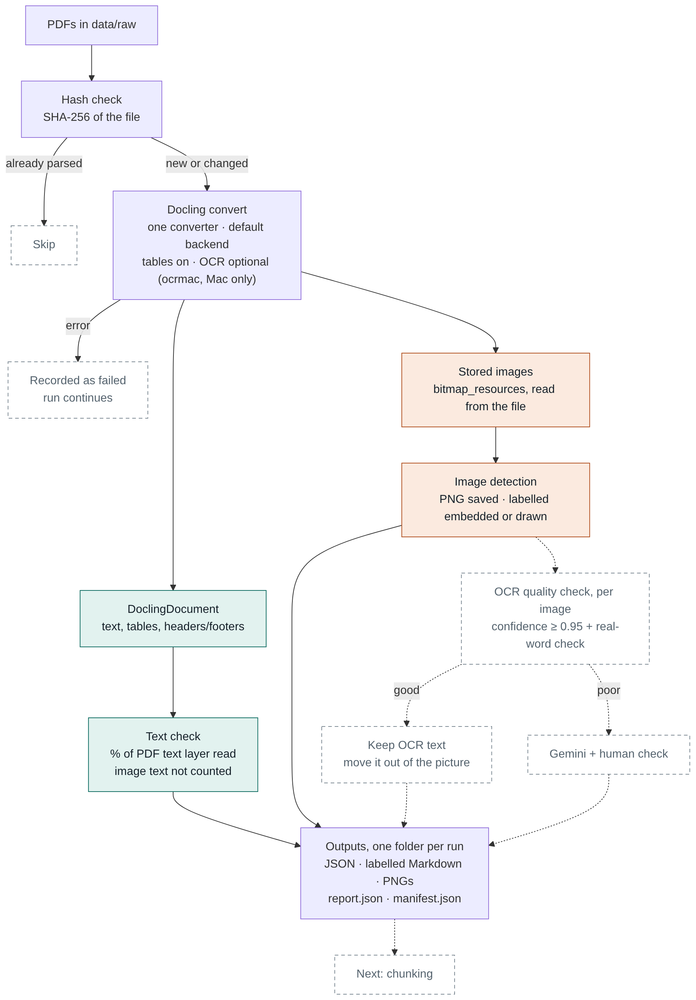
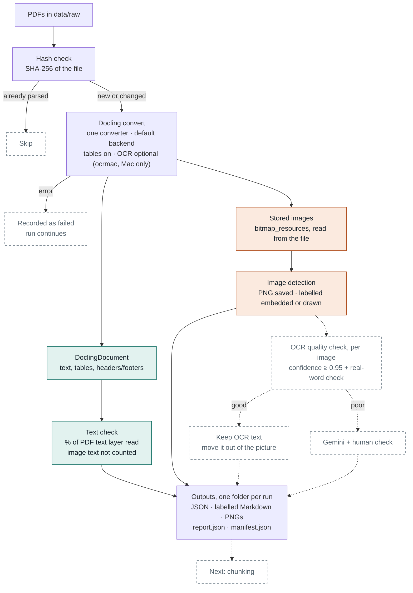

# RAG Data Management

Research project on best practice for managing the data behind a RAG (retrieval-augmented generation) system: how to turn real-world PDFs into clean, structured, versioned text, and how to show that this makes answers more reliable.

The project has four parts:

| Part | Tool | Purpose |
|---|---|---|
| 1 | **Docling** | Turn PDFs into clean, structured text: tables, images, metadata, chunking |
| 2 | PostgreSQL + pgvector | Store chunks with metadata so outdated editions can be marked superseded |
| 3 | LlamaIndex | RAG framework that connects the parts |
| 4 | Benchmarking | Show that parts 1–3 improve reliability and accuracy |

This repository currently covers **part 1, the Docling stage**.

**Corpus:** UOW Malaysia College Undergraduate Handbook, 2025 and 2026 editions (public documents, not included in the repo).

---

## Setup

```bash
python3.12 -m venv .venv
source .venv/bin/activate
pip install -r requirements.txt
```

Versions used for the results below: docling 2.135.0, docling-core 2.101.0, docling-parse 7.22.2, pypdfium2 5.14.0, ocrmac 1.0.1 (macOS only, used for the OCR tests).

Put the PDFs in `data/raw/`:

```
data/raw/handbook_2025.pdf
data/raw/handbook_2026.pdf
```

`data/` is in `.gitignore`, so neither the PDFs nor the parsed output are committed.

## Run

```bash
python pipeline.py
```

Output goes to `data/parsed/<RUN_NAME>/`:

| File | Contents |
|---|---|
| `<file>.json` | Full DoclingDocument. This is the complete record and the input for chunking. |
| `<file>.md` | Readable body text. Each picture is labelled `embedded image` or `drawn picture` instead of `<!-- image -->`. |
| `<file>_p<N>_stored_<i>.png` | Each image stored inside the PDF, at its original resolution |
| `manifest.json` | SHA-256 of each parsed file with its full result. Files already parsed are skipped. |
| `report.json` | Settings, package versions and one record per PDF for this run |

Change `RUN_NAME` whenever a setting changes, so runs can be compared and nothing is overwritten.

To read the text inside images with Apple's OCR (macOS only), set `DO_OCR = True` and use a new `RUN_NAME`. The OCR only runs on areas with no PDF text, so the normal text is not affected.

`p6_readers.py` is the test behind the OCR findings below. It runs page 6 of both handbooks through Docling's built-in readers (ocrmac, ocrmac on the full page, and the SmolVLM picture describer) and writes what each one read to `data/parsed/p6_readers.txt`.

---

## Architecture



<details>
<summary>Mermaid source</summary>



</details>

### Steps

1. **Hash check.** Each PDF gets a SHA-256 fingerprint. If that exact file was already parsed in this run and its JSON still exists, it is skipped. The hash identifies the file; the "Updated as of" date identifies the edition.
2. **Docling convert.** One converter per run. `generate_parsed_pages=True` and `include_bitmap_images=True` keep the list of images stored in the PDF, with their pixels. A PDF that fails is recorded with its error and the run continues.
3. **Text check.** Every word Docling kept (text, list markers, table cells, headers and footers) is compared with the PDF's text layer, read separately with pypdfium2. Gives a percentage and flags pages where more than 5% (and at least 3 words) are missing. Text inside images is not in the text layer, so it is not counted.
4. **Image detection.** For each image stored in the PDF: page, position, share of the page, pixel size, and page type (`image_only` if the image covers more than 30% of the page and the page has fewer than 30 body words, otherwise `mixed`). Each image is saved as a PNG.
5. **Picture labels.** Docling's layout model also marks areas that look like pictures. A picture that sits inside a stored image is labelled `embedded image`; anything else is labelled `drawn picture`.
6. **OCR quality check and Gemini (planned).** With OCR on, each image's OCR text would be checked (confidence of at least 0.95 plus a real-word check). Good text is kept and moved out of the picture; poor text goes to Gemini with a human check. `read_image_with_gemini()` is an empty placeholder for that step.
7. **Outputs.** Written to the run folder (see above).

### Settings

| Setting | Value | Why |
|---|---|---|
| PDF backend | docling-parse (default) | The only backend that returns stored images (`bitmap_resources`). The pypdfium2 backend returned none. |
| OCR | off by default; `DO_OCR = True` uses ocrmac | The handbooks have a text layer. OCR is only needed for text inside images. ocrmac is Apple's OCR and runs on macOS only. |
| Table structure | on, `ACCURATE` | Docling default |
| `generate_parsed_pages` | `True` | Keeps the stored-image list after parsing |
| `include_bitmap_images` | `True` | Decodes the stored images' pixels, not just their positions |
| Text-check reference | pypdfium2 text layer | Independent of the backend used for parsing |

---

## Results (run `pipeline_v1`, 15 Oct 2026)

| | 2025 handbook | 2026 handbook |
|---|---|---|
| Pages | 56 | 55 |
| Parse time | 15.3 s | 11.5 s |
| Text layer read | **99.89%** (18 of 16,524 words missing) | **99.66%** (57 of 16,590 words missing) |
| Flagged pages | none | none |
| Images stored in the PDF | 3 | 3 |
| p. 6 | mixed, 1378×903 px, 27% of page | mixed, 1378×903 px, 27% of page |
| pp. 7–8 | image-only, 1831×1294 px, 51% of page | image-only, 1831×1294 px, 51% of page |
| Layout-model pictures | 12 (8 embedded, 4 drawn) | 7 (3 embedded, 4 drawn) |
| Updated as of | 2025-01-22 | 2026-05-13 (cover); footers say 2026-01-10 |

### With OCR on (run `pipeline_v2_ocrmac`, ocrmac)

| | 2025 handbook | 2026 handbook |
|---|---|---|
| Text layer read | 99.89% (unchanged) | 99.66% (unchanged) |
| Normal text lost | 0 words on every page | 0 words on every page |
| Words added on p. 6 (Graduate Attributes image) | 208, accurate | 208, accurate |
| Words added on p. 1 (cover logos) | 15: logo text plus junk such as `₴18,88` | 14: logo text plus junk |
| Words added on pp. 7–8 (academic calendar) | 47 and 51, mostly garbage | 46 and 27, mostly garbage |
| Words added on any other page | 0 | 0 |

### Built-in readers on p. 6 (`p6_readers.py`)

| Reader | Result | Reaches the chunks |
|---|---|---|
| Default settings | Nothing read | — |
| ocrmac (Apple OCR) | All ~208 words, headings and bullets in order, 1 error ("Bea" for "Be a") | 2025: ~190 words; 2026: 1 word |
| ocrmac, full page | Same as above | Same as above |
| SmolVLM (picture describer) | 2025: described the icons only. 2026: 13 of 20 bullets, all under one heading, reworded, one invented line | Yes |
| RapidOCR | Crashed Python on macOS (segmentation fault in its image-resize step) | — |

### OCR confidence (`ocr_confidence_test.py`)

| Image type (test PDFs) | OCR confidence, page average |
|---|---|
| Text-based image (Graduate Attributes) | 1.00, every line, both editions |
| Logos | 0.90–0.91 (real logo text 1.00, junk lines 0.30) |
| Dense, table-like image (academic calendar) | 0.63–0.86 |

## Findings

**Docling can tell which images are stored in the PDF.** Read from the file (`bitmap_resources`, or the native pipeline), it finds exactly 3 stored images per edition on pp. 6, 7 and 8, with the same pages and pixel sizes as `pdfimages`. This does not depend on any AI model.

**With default settings it does not read the text inside them.** p. 6 (Graduate Attributes) has about 208 words that exist only inside its image. pp. 7–8 (academic calendar) are images with no text layer.

**Its built-in OCR can read them, at least on macOS.** With ocrmac (Apple's OCR), Docling read the p. 6 image text almost perfectly in both editions: about 208 words, headings and bullet points in order, one error. Running OCR on the whole file changed none of the normal text. The academic calendar stays unreadable even with ocrmac, and the cover logos add some junk. An earlier OCR run with a different engine on pp. 7–8 also produced mostly noise. Granite and GLM-OCR returned nothing there; LightOnOCR returned text that has not been checked yet.

**But Docling stores OCR text inside the picture.** Its standard exports (Markdown, and the default chunker) skip picture contents, so in 2026 only 1 of the 208 words reaches the chunks. In 2025 about 190 words get through, but only because the layout model split the image into small icons and the text ended up outside them. The text has to be moved out of the picture, or into the picture's description, which does reach the chunks. This is left for the chunking stage.

**OCR confidence is a useful first filter, but not enough on its own.** Docling keeps a confidence score per OCR line (`result.pages[...].parsed_page.textline_cells`) and an average per page (`result.confidence.pages[n].ocr_score`). On the test PDFs, the well-read image scored 1.00 and the badly read ones scored lower, so a cut-off around 0.95 separated them. But some clearly wrong lines still scored 1.00, and ocrmac's scores are coarse (0.3 / 0.5 / 1.0), so the cut-off is not proven beyond these PDFs. A second check, such as whether the OCR words are real words, is needed. The scores are not saved in the JSON, and docling-serve only returns one OCR score for the whole document.

**Whether an image can be read depends on the image, not the page.** OCR runs on each image area separately, so a dense table-like image fails the same way whether or not the page also has normal text. Quality should be judged per image, not by page type.

**Its built-in picture describer is not reliable.** SmolVLM's output reaches the chunks, but on 2026 p. 6 it kept 13 of 20 bullet points, put them all under one heading, reworded several and added a line that is not in the image. On 2025 it only described the icons.

**The layout model's "pictures" are a different thing.** It also marks the four drawn logos on the cover, which are not stored images. On 2025 p. 6 it sometimes splits the single stored image into 6 small icons and sometimes keeps it as 1 picture, with the same Docling version and settings. So embedded-image detection is based on the stored-image list, not on the layout model.

**The JSON keeps more than the Markdown.** Against an independent reference (`pdftotext`), the JSON keeps about 99.9% of the text layer and the default Markdown export about 95.6%. The difference is mostly headers and footers, which the Markdown export leaves out by default, and which is where most "Updated as of" dates are. Chunking should read the JSON.

**Text that crosses a page break is kept together.** The "Retake" paragraph runs from p. 28 to p. 29. Docling stores it as one item with two page references. Code that only reads `prov[0]` counts it all on p. 28.

**Backends are almost equal on text.** docling-parse and pypdfium2 both read 99.89% of the 2025 text layer. On 2026, pypdfium2 does slightly better (99.77% vs 99.55%) because docling-parse splits more superscripts (`10th` → `10` + `th`). docling-parse is still used because it is the only one that returns stored images.

## Known gaps

- Image-only pages (the academic calendar, pp. 7–8) are not handled. They are detected and recorded as a known gap.
- OCR text from images is stored inside the picture and does not reach the chunks yet.
- ocrmac only runs on macOS. OCR on Linux (for docling-serve on the server) is untested; RapidOCR crashed on macOS.
- With OCR on, the image-only rule counts OCR text as page text, so pp. 7–8 can be wrongly labelled `mixed`. The rule should count only the PDF's own text layer.
- Graphics drawn with lines and shapes are not stored images, so they are not detected as embedded images. Their text labels are usually still extracted as normal text.
- Running the script again with nothing new overwrites `report.json` with "skipped" entries. The full results stay in `manifest.json`.

## Notes for docling-serve (n8n)

- Request JSON output, not only Markdown.
- Use the default PDF backend.
- Still to check: whether docling-serve can return the stored images and their positions, and which backends it offers.

## Next steps

- Test an OCR engine on Linux, where docling-serve will run.
- Add a real-word check next to OCR confidence, and record confidence per image in `report.json`.
- Route only images that fail these checks to Gemini, with a human check.
- Try Gemini on the stored p. 6 image and compare it with the OCR text, as a comparison and as the fallback where OCR is not available.
- Fix the image-only rule so it counts only the PDF's own text layer.
- Decide whether "embedded images" means every stored image or only ones that carry information.
- Decide which date counts as an edition's version (cover or footer).
- Chunking: move OCR text out of the picture (preferred: copy it into the picture's description, only for mixed pages, so calendar and logo junk stay out), and handle Gemini's 2,048-token embedding limit.
